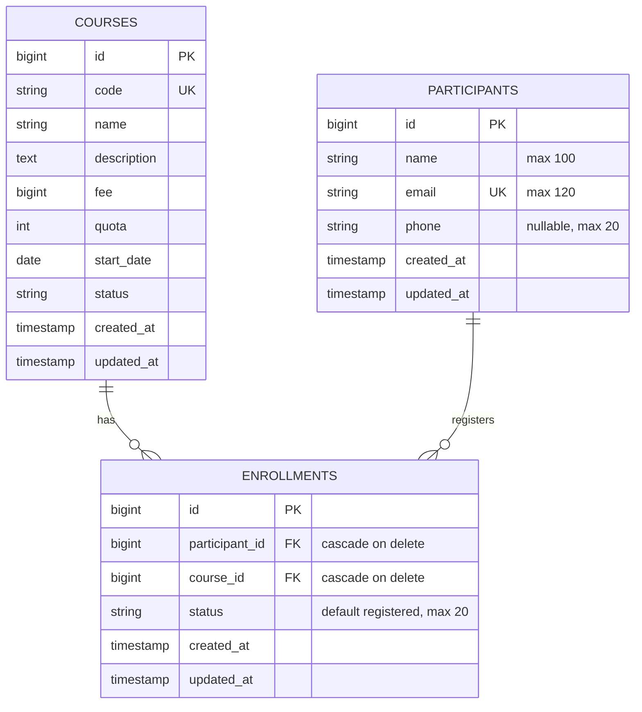

# ERD Final — KursusKu Pertemuan 12

Constraint unik pada `enrollments`: gabungan (`participant_id`, `course_id`). Artinya seorang peserta hanya memiliki satu pendaftaran untuk course yang sama. Course dan Participant tetap bisa memiliki banyak enrollment.

ERD ini merepresentasikan migration aktual project; migration `courses` berasal dari pertemuan sebelumnya dan tidak diubah.
